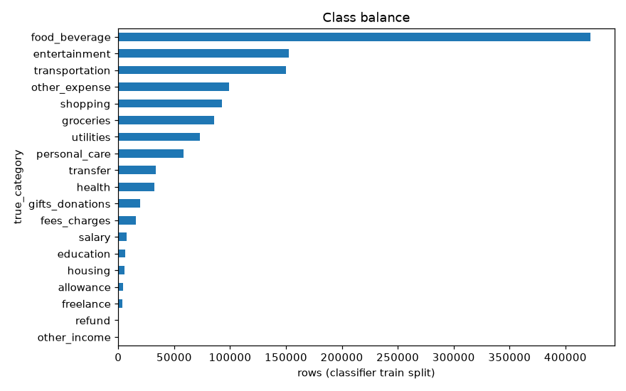
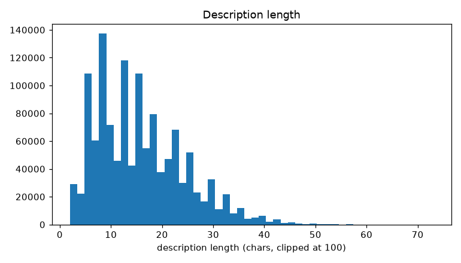
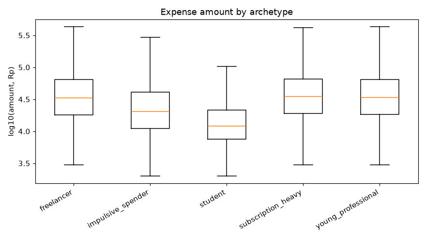

# Exploratory data analysis: synthetic dataset v1

All numbers below come from one real run of `uv run python -m ml.eda.run_eda` on `data/synthetic/v1`
(generator 1.1.0, seed 42, split_hash `cc7b019c…8b1b3d`). They use only the **classifier train split**
(1,263,380 of 2,171,358 rows), so validation and test data were not inspected.
Everything here describes **synthetic** data produced by this project's own generator. It says nothing about real user behaviour.
Figures: `docs/figures/`. Raw stats: `data/eda_stats.json` (gitignored, regenerated by the command above).

## 1. Class balance (label = `true_category`)

- `food_beverage` is the largest class (422,566 rows, 33%). `other_income` is the smallest (359 rows). Max/min ratio is about 1,177.
- Expense classes are comfortably populated (smallest: `fees_charges` 15,737, `gifts_donations` 19,494). Income classes are tiny: `refund` 613, `other_income` 359, `freelance` 3,430.
- Row types: expense 96.1%, transfer 2.6%, income 1.3%.

Implications for T-09/T-10:
- Report **macro-F1 and per-class recall**, not accuracy; accuracy is dominated by `food_beverage`, `entertainment`, `transportation`.
- Income labels are decided mostly by `transaction_type`; PRD 4.6 restricts valid categories by type, so the model's real task is the 13 expense classes plus a few transfer/income ones.
- Use class weights or stratified sampling only if the baseline shows weak recall on rare classes. Not decided yet.

## 2. Description text

- Length: median 14 characters, 95th percentile 32, 99th percentile 40, max 73. Median 2 tokens.
- Very short texts mean word n-grams alone are thin; character n-grams (PRD 11.1 candidates) should matter.
- 38.8% of rows have an empty `merchant` column, so the classifier cannot count on it. 14.9% of rows have a date but no time.
- Descriptions carry the noise the generator injects: casing changes (`transjAkarta`), payment prefixes (`DANA MIE GACOAN`, `OVO/SHOPEEFOOD`), branch suffixes (`GoFood @ BSD`). T-07 `normalize_merchant` must handle these.

## 3. Amounts by archetype (expenses, Rp)

| archetype | rows | median | mean | 95th pct |
|---|---|---|---|---|
| student | 353,956 | 12,000 | 18,061 | 52,500 |
| impulsive_spender | 172,583 | 20,500 | 39,804 | 127,000 |
| freelancer | 123,185 | 33,000 | 63,437 | 194,900 |
| young_professional | 449,319 | 33,500 | 67,672 | 225,500 |
| subscription_heavy | 114,580 | 35,000 | 71,206 | 300,000 |

- Amounts are heavily right-skewed (mean about 2x median), so features use `log1p(amount)` (PRD 11.1) and anomaly detection should work on per-user log-scale deviations.
- Archetypes differ clearly in scale, which is why anomaly thresholds must be per user (PRD 7.6), not global.
- Median amount by category ranges from Rp 5,000 (`fees_charges`) and Rp 12,000 (`transportation`) up to Rp 1,100,000 (`housing`), so amount is a useful secondary signal for the classifier.
- Transactions per user (train split): median 623, 5th to 95th percentile 484 to 894. This reflects the generator's `daily_tx_lambda`, an illustrative input, not a real statistic.

## 4. Label ambiguity

Four merchants intentionally appear under two categories (PRD 10.1, `ambiguous_with` in `config/generator/merchants.yaml`):

| merchant | label counts (train) |
|---|---|
| Indomaret | groceries 20,295 / personal_care 20,275 |
| Shopee | shopping 20,243 / food_beverage 19,731 |
| ShopeeFood | food_beverage 17,781 / shopping 17,781 |
| Watsons | health 1,452 / personal_care 1,425 |

- These merchants account for 9.4% of train rows; the minority label of each merchant is 4.7% of rows.
- Because the split inside each merchant is close to 50/50, **no text-only model can beat chance on these rows**. Using amount, payment method, and time of day may help a little. This sets a ceiling on achievable accuracy of roughly 95.3% on this dataset, assuming everything else is classified perfectly. Report results against that ceiling.
- Caution: this is an intentional design property of the generator. Real data would have different ambiguity.

## 5. Other properties

- Anomaly rows: 1.00% of train expenses (target about 1%).
- Recurring rows: 3.3% of train rows.
- Payment methods: e_wallet 41%, qris 17.5%, cash 13.6%, debit_card 11.3%, bank_transfer 8.5%, credit_card 7.3%, other 0.4%.

## 6. Open observations for later tasks

- The unseen-merchant test set is 16.8% of all rows; its category mix was not inspected here (test data not touched). Check it in T-09 when it is first used.
- Merchant normalization (T-07) can be validated against `true_merchant`, which is a ground truth the real product will not have.
- Amount scales were calibrated by hand (see `docs/DECISIONS.md`, T-03); do not quote these figures as real Indonesian spending.
