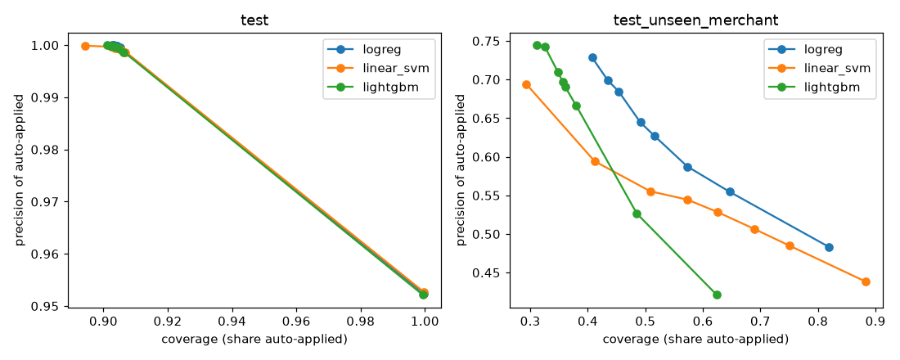

# Model evaluation

Results below come from one real run: `uv run python -m ml.classification.train` (run `20261120-024213`,
MLflow experiment `classifier`, run `bbf88d539f9b40ccafb82b94492d98ff`, registered as
`transaction-classifier` version 1 with alias `candidate`). Dataset `synthetic/v1`
(generator 1.1.0, seed 42, split_hash `cc7b019c3718c3b21f7756892314356fb0ae15eb603dc6b3c16046a19e8b1b3d`),
`features-1`, `taxonomy-1`. **All data is synthetic**; numbers say nothing about real users.

## 1. Transaction classifier (T-09)

### Setup
- Candidates (PRD 9.1): baseline TF-IDF + multinomial Logistic Regression (`class_weight=balanced`), calibrated Linear SVM, LightGBM on TF-IDF + numeric features. Config: `config/train/classifier.yaml`.
- Decision rule fixed before training: a candidate ships only if validation macro F1 is at least 2.0 points above the baseline. Selection used the **validation** split; the test splits were not used to choose.
- Calibration: one-vs-rest isotonic regression, renormalized, fitted on the validation split. ECE with 15 bins.
- **Training-set cap:** at most 25,000 rows per class (313,760 of 1,263,380 train rows; rare classes kept in full) because of memory and time. LightGBM used a smaller vocabulary (14,320 features instead of 38,429) and at most 8,000 rows per class (112,176 fit rows, with early stopping on a 10% slice). No learning-curve experiment was run, so the effect of the cap is unmeasured.

### Results

| model | val macro F1 | test macro F1 | test accuracy | unseen-merchant macro F1 | unseen accuracy | test ECE before | test ECE after | unseen ECE after | fit time |
|---|---|---|---|---|---|---|---|---|---|
| **logreg (baseline)** | 0.9693 | 0.9687 | 0.9523 | **0.5231** | 0.4543 | 0.0222 | 0.0007 | 0.3148 | 86 s |
| linear SVM | 0.9696 | 0.9692 | 0.9525 | 0.4040 | 0.4279 | n/a (no probabilities) | 0.0006 | 0.3980 | 266 s |
| LightGBM | 0.9699 | 0.9692 | 0.9519 | 0.3146 | 0.3749 | 0.0242 | 0.0015 | 0.3193 | 348 s |

**Decision: ship the baseline (Logistic Regression).** Neither candidate gained 2.0 points on validation (best gain: LightGBM +0.06 points). The SVM and LightGBM are negative results: more complexity, no measurable benefit, and worse on unseen merchants.

### Findings

1. **The temporal test is saturated.** Test accuracy is 0.952, equal to the ceiling implied by the intentionally ambiguous merchants (about 95.3%, `docs/EDA.md` section 4). The three models differ by 0.0005 in macro F1, which is within noise. This test mostly measures memorization of known merchants and cannot rank the models.
2. **Unseen merchants are the real difficulty.** On merchants never seen in training, macro F1 drops to 0.52 (accuracy 0.45). Linear models with character n-grams beat LightGBM here (0.52 vs 0.31). Per-category F1 on unseen merchants is very uneven: `housing` 0.98, `allowance` 0.98, `transfer` 1.0, versus `shopping` 0.00, `entertainment` 0.00, `personal_care` 0.01, `utilities` 0.07. Without a merchant in the vocabulary, the text carries little category signal in this synthetic world.
3. **Calibration does not transfer to unseen merchants.** ECE is 0.0007 on the temporal test but 0.31 on unseen merchants (before calibration: 0.20 for LR). Even at confidence >= 0.99 only 72.9% of unseen-merchant predictions are correct (coverage 40.7%). Thresholds chosen on the validation split (T-10) will therefore be too optimistic for new merchants. Mitigations to consider: a novelty signal (merchant never seen by this user or in training) that lowers confidence, and conservative `t_high` with human review for unknown merchants.
4. **Coverage-accuracy (temporal test):** at confidence >= 0.6, 90.5% of rows are auto-applied at 99.95% precision. The remaining 9.5% are the intentionally ambiguous merchants, where confidence drops to about 0.5, which is the correct behaviour for coin-flip labels.
5. **Error analysis:** the 50 most confident mistakes on the test split are all rows of intentionally ambiguous merchants (ShopeeFood 13, Shopee 10, Watsons 5, ...) plus a few others (Vivo 6, Gojek 2). Calibration is correct on average per bin, but individual rows can be over-confident when the raw score is extreme; per-merchant calibration is not attempted.
6. **Slices (test macro F1 by archetype):** student 0.89, impulsive_spender 0.94, freelancer 0.96, subscription_heavy 0.96, young_professional 0.97. The reason student is lowest was not investigated. Unseen-merchant macro F1 by archetype ranges from 0.45 to 0.58.

### Plots

### Not done yet (and why it matters)
- **Circularity check (PRD 9.6.6)**: `config/generator/holdout_variant.yaml` does not exist yet, so there is no evaluation on a different generator variant. Results above can overstate real performance because train and test come from the same generator.
- **Latency SLO (PRD 9.1 ship rule, 16.3)**: only a rough measurement exists (P95 about 24 ms per row for transform + score + calibrate, single process, on a busy development machine, excluding feature extraction and HTTP). The standard benchmark belongs to T-17/T-30.
- **Learning curve** for the 25k-per-class cap, and **thresholds** (`t_high`, `t_low`): T-10.
- No public dataset was evaluated (Q1 decision, `docs/DATA_SOURCES.md`).
