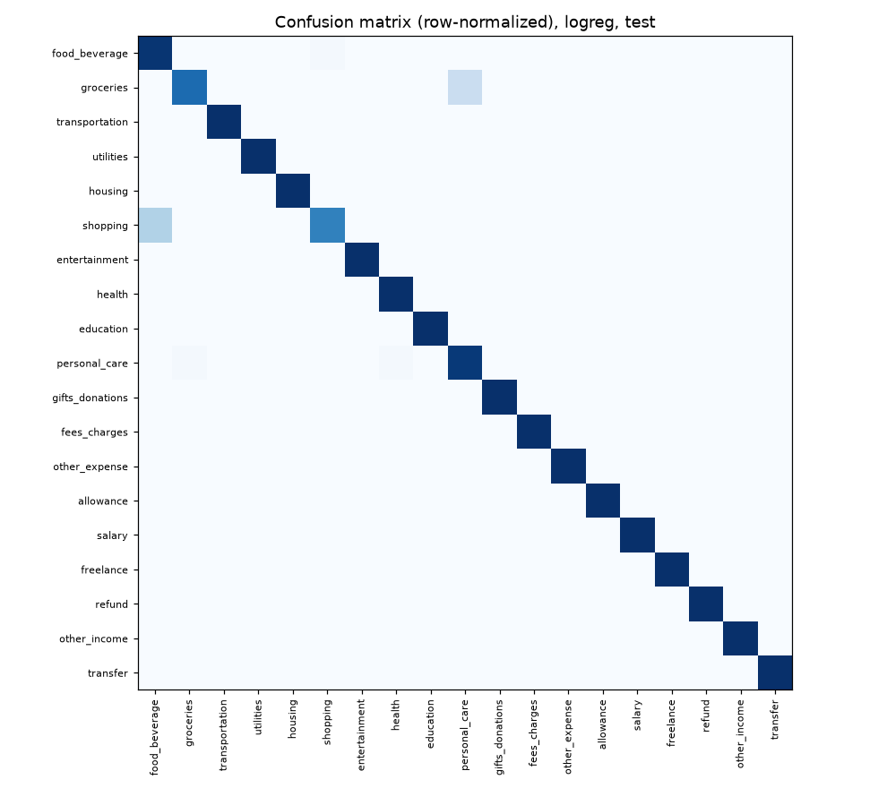

# Model evaluation

Results below come from one real run: `uv run python -m ml.classification.train` (run `20261120-024213`,
MLflow experiment `classifier`, run `bbf88d539f9b40ccafb82b94492d98ff`, registered as
`transaction-classifier` version 1 with alias `candidate`). Dataset `synthetic/v1`
(generator 1.1.0, seed 42, split_hash `cc7b019c3718c3b21f7756892314356fb0ae15eb603dc6b3c16046a19e8b1b3d`),
`features-1`, `taxonomy-1`. **All data is synthetic**; numbers say nothing about real users.

## 1. Transaction classifier (T-09)

### Setup
- Candidates (PRD 9.1): baseline TF-IDF + multinomial Logistic Regression (`class_weight=balanced`), calibrated Linear SVM, LightGBM on TF-IDF + numeric features. Config: `config/train/classifier.yaml`.
- Decision rule fixed before training: a candidate ships only if validation macro F1 is at least 2.0 points above the baseline. Selection used the **validation** split; the test splits were not used to choose.
- Calibration: one-vs-rest isotonic regression, renormalized, fitted on the validation split. ECE with 15 bins.
- **Training-set cap:** at most 25,000 rows per class (313,760 of 1,263,380 train rows; rare classes kept in full) because of memory and time. LightGBM used a smaller vocabulary (14,320 features instead of 38,429) and at most 8,000 rows per class (112,176 fit rows, with early stopping on a 10% slice). No learning-curve experiment was run, so the effect of the cap is unmeasured.

### Results

| model | val macro F1 | test macro F1 | test accuracy | unseen-merchant macro F1 | unseen accuracy | test ECE before | test ECE after | unseen ECE after | fit time |
|---|---|---|---|---|---|---|---|---|---|
| **logreg (baseline)** | 0.9693 | 0.9687 | 0.9523 | **0.5231** | 0.4543 | 0.0222 | 0.0007 | 0.3148 | 86 s |
| linear SVM | 0.9696 | 0.9692 | 0.9525 | 0.4040 | 0.4279 | n/a (no probabilities) | 0.0006 | 0.3980 | 266 s |
| LightGBM | 0.9699 | 0.9692 | 0.9519 | 0.3146 | 0.3749 | 0.0242 | 0.0015 | 0.3193 | 348 s |

**Decision: ship the baseline (Logistic Regression).** Neither candidate gained 2.0 points on validation (best gain: LightGBM +0.06 points). The SVM and LightGBM are negative results: more complexity, no measurable benefit, and worse on unseen merchants.

### Findings

1. **The temporal test is saturated.** Test accuracy is 0.952, equal to the ceiling implied by the intentionally ambiguous merchants (about 95.3%, `docs/EDA.md` section 4). The three models differ by 0.0005 in macro F1, which is within noise. This test mostly measures memorization of known merchants and cannot rank the models.
2. **Unseen merchants are the real difficulty.** On merchants never seen in training, macro F1 drops to 0.52 (accuracy 0.45). Linear models with character n-grams beat LightGBM here (0.52 vs 0.31). Per-category F1 on unseen merchants is very uneven: `housing` 0.98, `allowance` 0.98, `transfer` 1.0, versus `shopping` 0.00, `entertainment` 0.00, `personal_care` 0.01, `utilities` 0.07. Without a merchant in the vocabulary, the text carries little category signal in this synthetic world.
3. **Calibration does not transfer to unseen merchants.** ECE is 0.0007 on the temporal test but 0.31 on unseen merchants (before calibration: 0.20 for LR). Even at confidence >= 0.99 only 72.9% of unseen-merchant predictions are correct (coverage 40.7%). Thresholds chosen on the validation split (T-10) will therefore be too optimistic for new merchants. Mitigations to consider: a novelty signal (merchant never seen by this user or in training) that lowers confidence, and conservative `t_high` with human review for unknown merchants.
4. **Coverage-accuracy (temporal test):** at confidence >= 0.6, 90.5% of rows are auto-applied at 99.95% precision. The remaining 9.5% are the intentionally ambiguous merchants, where confidence drops to about 0.5, which is the correct behaviour for coin-flip labels.
5. **Error analysis:** the 50 most confident mistakes on the test split are all rows of intentionally ambiguous merchants (ShopeeFood 13, Shopee 10, Watsons 5, ...) plus a few others (Vivo 6, Gojek 2). Calibration is correct on average per bin, but individual rows can be over-confident when the raw score is extreme; per-merchant calibration is not attempted.
6. **Slices (test macro F1 by archetype):** student 0.89, impulsive_spender 0.94, freelancer 0.96, subscription_heavy 0.96, young_professional 0.97. The reason student is lowest was not investigated. Unseen-merchant macro F1 by archetype ranges from 0.45 to 0.58.

### Decision thresholds (T-10)

Chosen on the validation split only (`config/train/classifier.yaml`, section `thresholds`; report in `evaluation/thresholds.json`):

| | value |
|---|---|
| `t_high` | **0.90** |
| `t_low` | **0.90** (the "suggest" band is empty) |
| flag | `no_suggest_band`: no confidence band below `t_high` reaches the 0.70 precision target |

| split | auto-apply share | auto-apply precision | needs-review share | needs-review precision |
|---|---|---|---|---|
| validation | 90.4% | 1.0000 | 9.6% | 0.5105 |
| temporal test | 90.4% | 0.9999 | 9.6% | 0.5042 |
| **unseen-merchant test** | **45.4%** | **0.6846** | 54.6% | 0.2631 |

Reading: on merchants the model has seen, 90% of rows are auto-categorized at near-perfect precision and the remaining 10% (the coin-flip merchants) go to review, which is the intended behaviour. On unseen merchants the same thresholds auto-apply 45% of rows at only 68% precision, far below the 0.95 target. **The 0.95 guarantee holds only for known merchants.** The PRD defaults (0.85 / 0.60) give the same validation outcome, so the data cannot prefer 0.90 over 0.85. Thresholds are not tuned on the unseen split (it is a locked test set); a novelty rule for unknown merchants is the open fix.

### Behavioural tests and latency (T-26)

Measured with `uv run python -m ml.classification.behavioural models/transaction-classifier/20261120-024213` (the T-09 baseline above; golden set `ml/tests/golden/classifier.yaml`, 114 hand-labelled cases, 6 per category, written without looking at model output).

| check | threshold (`config/train/classifier.yaml`) | result |
|---|---|---|
| golden accuracy | >= 0.95 (PRD 21.4) | **0.781 (89 of 114): fails** |
| minimum functionality (>= 2 of 3 right per category) | every category | **fails** for allowance, education, entertainment, fees_charges, other_expense, refund, shopping, transportation |
| invariance, top-1 unchanged (typo / reference prefix / case + location) | >= 0.90 each | 0.930 / 0.965 / 1.000 (passes) |
| latency, 1,000 replayed requests, 2 CPU threads | P95 <= 200 ms | P50 20.9 ms, P95 25.8 ms, P99 29.7 ms (passes; this machine, one run, not an SLO measurement) |

Reading: the model is robust to typos, reference numbers and casing, but it does not generalize to descriptions that look unlike the synthetic generator's templates (for example `BPJS KESEHATAN IURAN` -> utilities, `STEAM GAMES PURCHASE` -> food_beverage, `PENGEMBALIAN DANA SHOPEE` -> other_income). This is the same weakness as the unseen-merchant result above, seen from the other side, and it means this version would not pass the offline gates (PRD 16.3, "behavioural tests"). The invariance threshold (0.90) was fixed before this measurement; the golden cases were not edited after it. Since the golden set reuses many merchants of the synthetic catalogue, real-world accuracy would be lower, not higher.

### Plots

### Not done yet (and why it matters)
- **Circularity check (PRD 9.6.6)**: `config/generator/holdout_variant.yaml` does not exist yet, so there is no evaluation on a different generator variant. Results above can overstate real performance because train and test come from the same generator.
- **Latency SLO (PRD 9.1 ship rule, 16.3)**: only a rough measurement exists (P95 about 24 ms per row for transform + score + calibrate, single process, on a busy development machine, excluding feature extraction and HTTP). The standard benchmark belongs to T-17/T-30.
- **Learning curve** for the 25k-per-class cap.
- **Novelty handling:** lowering confidence (or forcing review) for merchants unseen in training or by the user.
- No public dataset was evaluated (Q1 decision, `docs/DATA_SOURCES.md`).

## 2. Recurring detection (T-30)

Rule-based (PRD 7.8), no model and no training. Measured with `make recurring-eval` (`uv run python -m ml.recurring.evaluate --users 1000 --seed 42`): 1,000 users sampled at random from `synthetic/v1`, each judged at the date of their last transaction, config `rules-2`. **All data is synthetic.**

Ground truth is the generator's `recurring_series_id`, which labels subscriptions and monthly bills (all monthly, expense). Habit merchants and income are not labelled, so some "false positives" may be real habits and income is only counted, not scored. A detected series is correct when more than half of its transactions carry one ground-truth series id; recall counts ground-truth series that have at least 3 transactions.

| variant (same 1,000 users) | detected expense series | precision | ground-truth series | recall |
|---|---|---|---|---|
| PRD 7.8 steps 1-8 only | 1,821 | 98.9% (1,801) | 3,090 | 58.3% |
| plus amount-cluster retry, no share guard | 3,015 | 91.2% (2,751) | 3,090 | 89.0% |
| **plus amount-cluster retry with the 50% share guard (shipped)** | **2,454** | **98.5% (2,416)** | **3,090** | **78.2%** |

Also detected in the shipped variant: 115 income series (90 monthly, 25 quarterly; not scored) and 29 quarterly expense series (counted as false positives, there is no quarterly ground truth).

Findings:
- The plain rules miss most series because a bill merchant is also used for ordinary purchases, so intervals are mixed. In a diagnosis of 399 missed series over 300 users, 279 shared their merchant key with non-recurring rows.
- Retrying on amount clusters recovers many of them, but without a guard it also finds coincidental regular subsets of busy merchants (176 spurious quarterly series). Requiring the cluster to hold at least half of the merchant's rows removes most of those at a cost of recall.
- The remaining 674 ground-truth series (21.8%) are not found. Diagnosis on the same users: in 605 of them the labelled bill rows are less than half of the merchant's expense rows (the generator also draws ordinary purchases from the same merchants, so the merchant is mostly something else), in 26 the other rows sit within 10% of the bill amount, and 43 have neither cause (not diagnosed further).
- The 98.5% precision is an upper bound for real data: the generator's subscriptions are monthly with 0-2 days of jitter and a constant price, which is easier than real billing.

Not done: no real transaction data was evaluated; income detection and the amount-change flag (FR-08.03) have unit tests but no ground truth; the decomposition has not been compared against the plain run rate on closed periods (`forecast_outcomes` arrives with T-37/T-38).

## 3. Anomaly detector: Isolation Forest and LOF vs the baseline (T-38)

Real run: `uv run python -m ml.anomaly_detection.model_train --users 2000 --cache data/anomaly_features.parquet` (MLflow experiment `anomaly-detector`, run `bb7dfea9eba6415f925bbb55f7ac9518`; an earlier 500-user run `e53d7da1b2804a15bf677d7fa66d6c5e` gave the same ranking). Dataset `synthetic/v1`, all 2,000 users, locked anomaly split (`data_splits/synthetic/v1`), features `anomaly-model-features-1`, config `config/train/anomaly.yaml`. The run was made from the working tree before the T-38 commit (the recorded commit `3a4f70d` is the parent), so it does not meet the clean-tree rule of PRD 16.3.

### Setup
- Both models are unsupervised and fitted on the **train** anomaly split only (1,452,951 expense rows): Isolation Forest (200 trees, 4,096 samples per tree) and LOF (35 neighbours, a 30,000-row sample of train because scoring is linear in the fit size). Features are the 17 user-relative features of PRD 11.2.2, each computed from the user's history strictly before the row (tested by injecting future rows). Raw scores are mapped to [0, 1] with the empirical CDF of the training scores.
- The flag threshold is chosen on **validation** (311,115 rows): maximum precision subject to recall >= 0.50 (PRD 7.6.3), then applied unchanged to **test** (312,776 rows). The baseline gets the same treatment: its ranking is the modified z-score, gated by the rule's amount conditions (>= Rp50,000 and >= 2x the typical amount), cold-start prior included.
- Labels are used only to score. Rows labelled `category_surge` are left out (a weekly pattern found by a rule, not a per-transaction score). In the `amount_spike` comparison, rows labelled `frequency_burst` or `new_merchant_high_value` are neither positives nor negatives. The "any anomaly" view treats all three per-transaction types as positives.

### Results: `amount_spike` (test split, 158 positives among 312,776 rows)

| scorer | flagged | precision | recall | PR-AUC | false positives per user per month |
|---|---|---|---|---|---|
| **baseline (modified z)** | 1,909 | **0.0377** | 0.456 | **0.0430** | 0.50 |
| Isolation Forest | 8,659 | 0.0079 | 0.430 | 0.0067 | 2.36 |
| LOF | 26,026 | 0.0027 | 0.443 | 0.0032 | 7.12 |

On validation the thresholds reach recall 0.52 (baseline), 0.51 (IF) and 0.50 (LOF); on test none of the three keeps 0.50, so the recall target is not met by any of them on unseen time. Limited-history rows (fewer than 30 prior transactions in the category) are too few to compare: 18 positives in 36,748 test rows.

"Any anomaly" view (1,496 positives, models only): Isolation Forest precision 0.019, recall 0.473, PR-AUC 0.047; LOF precision 0.025, recall 0.503, PR-AUC 0.053. Recall by type at the `amount_spike` threshold (baseline / IF / LOF): `amount_spike` 0.456 / 0.430 / 0.443, `frequency_burst` 0.002 / 0.105 / 0.429, `new_merchant_high_value` 0.811 / 0.832 / 0.737.

**Decision: the baseline stays for `amount_spike`.** Neither model beats it on test precision at recall about 0.5 (IF -3.0 points, LOF -3.5 points), which is the rule of PRD 7.6.3 and 16.3. Nothing is registered and no `/v1/anomaly/score` endpoint is built; the three other types stay rule-based as in the PRD.

### Findings
1. The gap is large (precision 4.8x lower for IF, 14x for LOF), so more users would not flip the verdict; the test has 158 positives, so individual precision figures carry wide error bars.
2. **The PRD 5.2 initial target (precision >= 0.70 at recall >= 0.50) is not met by anything**: 0.038 is the best. Absolute precision is low for every scorer. The labelled spikes are 0.06% of expense rows and the generator also produces natural large purchases, so most flags are not labelled anomalies. The baseline's 0.5 false positives per user per month is inside the product target of 3 (PRD 9.3); IF at 2.4 is too, LOF at 7.1 is not.
3. Hypothesis, not tested: a spike is mostly a single feature (`z_cat`), and the other 16 features add rows that are unusual for unrelated reasons, so the forest ranks them above real spikes. An ablation on `z_cat` alone was not run.
4. LOF is the only scorer with a useful recall on `frequency_burst` (0.43), but at 7 false positives per user per month; bursts stay with the Poisson rule.
5. Synthetic data: the generator draws spikes as multiples of a category's typical amount, the same signal the baseline measures, which favours the baseline. A holdout generator variant (PRD 9.6 item 6) was not run.

## 4. Forecaster: ETS and LightGBM quantile vs run-rate and seasonal naive (T-38)

Real run: `uv run python -m ml.forecasting.model_eval` (MLflow experiment `expense-forecaster`, run `8e75d9a7d4ff4ede93b8d04eebeb864e`; an earlier identical run `8affb234179c46ef80a66e49a3d56b99` lacks the seasonal-naive check). Dataset `synthetic/v1`, forecast config `forecast-model-1` (`config/train/forecast.yaml`), baseline config `run-rate-2`, features `forecast-model-features-1`. Same dirty-tree remark as section 3.

### Setup
- **150 users** (SHA-256 sample), **2,400 evaluated origins**: day 5, 10, 15 and 20 of each of the last four periods of each user (`forecast_periods.csv`, periods start on day 1 or day 25). Target: period total of non-recurring expenses (PRD 7.7.1).
- Baseline: `ml.forecasting.baseline.forecast` as shipped in T-24 (seasonal naive here, since every user has more than 60 days of history), and its `baseline_prediction` (run-rate). ETS: per-user additive error and seasonality (period 7) on the last 112 days, interval = sum of the forecast +- 1.2816 x residual std x sqrt(days left); no fit failed. LightGBM: three quantile models (0.1, 0.5, 0.9), global, trained once on 26,156 origins from the periods that end before each user's first evaluated period; crossings fixed by sorting.
- Deviation from PRD 11.2.3 and 7.7.3: the LightGBM predicts the **remaining total** directly (one row per origin, `days_remaining` instead of a per-day `days_ahead`), with level features divided by the user's 56-day mean. The sum of daily quantiles is not the quantile of the sum, and only the total is needed.
- MASE is scaled by the in-sample MAE of the seasonal-naive forecast (lag 7 days) of a total of the same number of remaining days, over the user's last 120 days before the origin. This is my reading of PRD 9.4 at the total level.

### Results (period total, 2,400 origins)

| model | WAPE | MAE (Rp) | MASE | P10-P90 coverage |
|---|---|---|---|---|
| run-rate | 0.2149 | 745,298 | 2.27 | 0.466 |
| **seasonal naive (current baseline)** | 0.1442 | 500,126 | 1.53 | 0.568 |
| ETS | 0.1413 | 490,256 | 1.51 | 0.718 |
| **LightGBM quantile** | **0.1251** | **433,878** | **1.34** | **0.770** |

WAPE (MASE) by origin day:

| day | run-rate | seasonal naive | ETS | LightGBM |
|---|---|---|---|---|
| 5 | 0.387 (4.12) | 0.184 (2.00) | 0.188 (2.03) | **0.156 (1.71)** |
| 10 | 0.217 (2.27) | 0.159 (1.66) | 0.156 (1.63) | **0.138 (1.45)** |
| 15 | 0.148 (1.56) | 0.130 (1.38) | 0.122 (1.31) | **0.115 (1.23)** |
| 20 | 0.107 (1.13) | 0.104 (1.08) | 0.099 (1.05) | **0.092 (0.95)** |

WAPE by archetype (run-rate / seasonal naive / ETS / LightGBM): student (864 origins) 0.205 / 0.138 / 0.139 / 0.121; young_professional (672) 0.203 / 0.139 / 0.134 / 0.119; freelancer (320) 0.218 / 0.152 / 0.147 / 0.136; subscription_heavy (320) 0.219 / 0.163 / 0.154 / 0.138; impulsive_spender (224) 0.256 / 0.128 / 0.143 / 0.116. LightGBM coverage by archetype is 0.75 to 0.79.

### Ship rule (PRD 9.1: WAPE below run-rate at days 5, 10, 15 and 20, and coverage within 0.70-0.90)
- **LightGBM: passes**, and also beats the seasonal naive baseline on every origin day and in every archetype (no slice gate failure).
- **ETS: passes the literal rule** (coverage 0.718) **but is not shipped**: it is worse than seasonal naive at day 5 (0.188 vs 0.184) and in `impulsive_spender` (0.143 vs 0.128), and its gain at the other days is 2 to 6% relative.
- Initial target of PRD 5.2 (WAPE at day 15 <= 20% and MASE < 1): WAPE is met by seasonal naive and both models; MASE < 1 only for LightGBM at day 20 (0.95), so that target is **not met**.

### Findings
1. The run-rate baseline is poor early in the period (WAPE 0.39 at day 5) and converges to seasonal naive by day 20, as expected.
2. **The interval shipped in T-24 under-covers**: the nominal P10-P90 range contains the actual total only 56.8% of the time (seasonal naive baseline), 46.6% for run-rate. LightGBM (77.0%) and ETS (71.8%) are in the 70-90% band. The UI's "range" for the current baseline is therefore too narrow on this data.
3. The LightGBM gain over seasonal naive is 13% in WAPE overall (0.144 to 0.125), larger early in the period (15% at day 5, 12% at day 20). The gap is moderate; whether it holds on real spending is unknown.
4. Only the overall non-recurring total was evaluated. Category forecasts, the recurring decomposition and users with fewer than 60 days of history were not.
5. Synthetic data: the generator has simple weekday and payday patterns that a tree model can learn; a holdout generator variant was not run.
6. The LightGBM was trained on the same users' earlier periods (production-like: "train on all data strictly before the origin"), but once, not refitted per origin.

## 6. Behavior clusterer (T-41)

Run: MLflow run `412782274ec04a02ac2f9b240653ee7e` (model name `behavior-clusterer`, config `clustering-1`), command `uv run python -m ml.clustering.train --write-model`. Synthetic dataset v1, 2,000 users with at least 2 complete periods, features over each user's last 3 complete periods (PRD 11.2.4, CLR for category shares).

### Ship rule (fixed in `config/clustering.yaml` before the run)

Silhouette >= 0.40, mean ARI across 5 seeds >= 0.80, every segment nameable from its centroid.

### Results

| k (K-Means) | 3 | 4 | 5 | 6 | 7 | 8 |
|---|---|---|---|---|---|---|
| silhouette | 0.4148 | **0.4355** | 0.3700 | 0.3676 | 0.2852 | 0.2641 |
| GMM (diag) silhouette | 0.4148 | 0.4354 | 0.3695 | 0.3588 | 0.2060 | 0.2092 |

- Selected k = 4 (best silhouette). Segment sizes 899 / 700 / 200 / 201.
- ARI across 5 seeds: mean 1.000, min 1.000. ARI between models fitted on the two user halves and applied to everyone: 1.000.
- DBSCAN (eps 2/3/4/5, min_samples 10): eps 3 gives 4 clusters with silhouette 0.4366 and 0.5% noise, so it agrees with K-Means; eps 2 gives 9 clusters (0.3715, 15% noise); eps 4 and 5 collapse to one cluster. K-Means was kept because it assigns every user and a new user needs only a centroid lookup.
- ARI against the generator archetypes (sanity only, FR-13.05): 0.836. `subscription_heavy` users fall into the same segment as `young_professional`; the other three archetypes each map to one segment.
- Ship rule: silhouette ok, ARI ok, names written by hand after reading the centroids (`config/clusterer_model.yaml`).

### Findings and caveats

- The numbers are high because the synthetic archetypes are well separated by construction. The stability figures (ARI 1.0) say the pipeline is deterministic and the groups are crisp in synthetic data; they say nothing about real users. Real-data silhouette and ARI: `[TBD after run]`.
- The segment names describe what the centroids show on synthetic data. They must be re-read when the model is refitted on other data.
- Not deployed: the artifact ships in `config/`; no MLflow registration or alias was made for it.
